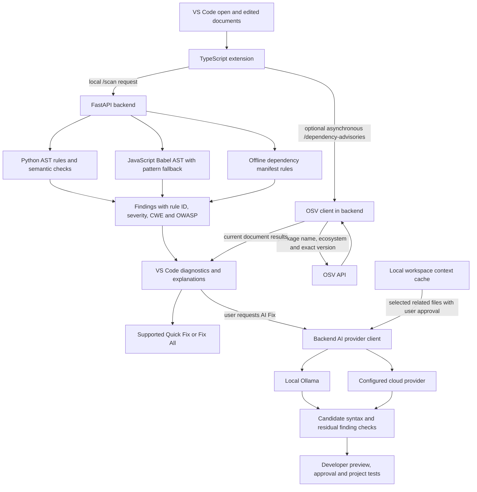

# CodeShield AI — Project Evaluation Report

Evaluated release: Windows x64 0.1.60. Implementation baseline: commit `56b2950`. Documentation prepared on 14 November 2026.

CodeShield AI is a functional VS Code prototype for selected Python, JavaScript and dependency-manifest security checks. P1 adds optional online dependency advisories to the existing local scanning and requested AI remediation workflows.

## Architecture

The extension owns document events, diagnostic publication, fix commands and the bounded workspace context cache. It manages the bundled backend lifecycle. FastAPI exposes local scan, advisory and AI suggestion endpoints.

The local analysis channel parses Python ASTs and uses JavaScript's Babel AST sidecar when available. JavaScript has a pattern fallback. Rules and semantic checks identify supported patterns within individual files. A workspace scan visits supported files independently, up to 2,000 files and a 512 KiB per-file limit, excluding common generated and dependency folders.

The asynchronous enrichment channel has two distinct triggers. Enabling `secureCoding.osvAdvisories` allows dependency lookups after a manifest scan in a trusted workspace. AI Fix runs when a developer requests remediation. Ollama runs locally, while configured cloud providers use external APIs. Neither selecting an AI model nor building the context cache starts AI vulnerability detection.

### A03 dependency advisories

Offline checks flag unbounded versions, mutable dependency sources and selected risky install scripts. Optional OSV enrichment supports direct dependencies in `package.json`, `requirements*.txt` and the `[project].dependencies` array in `pyproject.toml`. It queries exact registry versions. Supported version ranges can be resolved from a sibling `package-lock.json`, `requirements.lock` or `constraints.txt`. Unresolved versions are skipped.

The OSV client batches up to 1,000 queries, applies timeouts and caches successful results by ecosystem, package name and version for six hours in the running backend. Results appear as `CS-A03-OSV`, including CVE aliases where available. A server error or timeout preserves the offline scan findings. The extension checks request freshness and document content/version before publishing a delayed response.

### A05 injection and contextual fixes

Rules identify selected SQL injection, command injection, dynamic execution, template injection and JavaScript XSS patterns. For example, `PY-SQLI-001` reports a supported dynamic SQL execution pattern as Critical, CWE-89, A05:2025 Injection. Its 2021 crosswalk is A03:2021 Injection.

Quick Fix and Fix All apply available deterministic edits with context checks. AI Fix receives the finding and code context, with an option to include selected related workspace files. The context cache is maintained by the extension using bounded file selection and simple relevance signals. It does not establish whole-program dependencies or authorization policy. Generated candidates undergo syntax and residual scanner checks before application is offered. Passing those checks still requires developer review and application testing.

## Selected OWASP Top 10:2025 checks

The implementation contains selected rule patterns mapped to all ten category labels. Each row describes a partial check. Category presence does not establish comprehensive detection within that category. Names follow the official [OWASP Top 10:2025 list](https://top10.owasp.org/2025/).

| Category | Examples implemented | Representative identifiers | Important boundary |
|---|---|---|---|
| A01 Broken Access Control | Path traversal, request-derived outbound URLs, potentially unscoped object lookups | `PY-PATH-001`, `JS-SSRF-001`, `PY-ACCESS-001` | Cannot establish ownership or the application's authorization policy |
| A02 Security Misconfiguration | Debug settings, selected CORS and TLS configuration patterns | `PY-CONFIG-001`, `JS-CONFIG-002`, `PY-TLS-001` | Does not audit deployed server configuration |
| **A03 Software Supply Chain Failures** | Offline manifest checks and optional OSV advisories for identified dependency versions | `DEP-UNPINNED-001`, `DEP-SOURCE-001`, `DEP-SCRIPT-001`, **`CS-A03-OSV`** | Limited manifests and resolution paths, requires OSV availability for online results, omits full transitive and pipeline analysis |
| A04 Cryptographic Failures | Weak hashes, fast password hashes and weak randomness in selected security contexts | `PY-CRYPTO-001`, `PY-PASSWORD-HASH-001`, `JS-RANDOM-001` | Cannot validate a complete cryptographic protocol or password migration |
| **A05 Injection** | Supported SQL, shell, dynamic execution, template and XSS patterns | **`PY-SQLI-001`**, `JS-SQLI-001`, `PY-CMD-001`, `JS-XSS-001` | File-local analysis can miss alternate APIs, wrappers or flows across files |
| A06 Insecure Design | Request-controlled privilege fields and selected model-update patterns | `PY-DESIGN-001`, `JS-DESIGN-002` | Cannot infer business requirements or prove authorization |
| A07 Authentication Failures | Credential-like literals, selected password comparisons and JWT misuse | `PY-SECRETS-001`, `PY-AUTH-001`, `JS-JWT-001` | Does not assess a complete login, session or identity system |
| A08 Software or Data Integrity Failures | Unsafe Python deserialization and selected JavaScript `unserialize()` calls | `PY-SERIAL-001`, `JS-SERIAL-001` | Does not audit all integrity mechanisms or treat ordinary JSON parsing as unsafe object deserialization |
| A09 Security Logging and Alerting Failures | Sensitive values and request data in selected log statements | `PY-LOG-001`, `JS-LOG-002` | Does not prove security event coverage, retention or alert delivery |
| A10 Mishandling of Exceptional Conditions | Empty/broad exception handling and selected success-like fallback patterns | `PY-EXCEPT-001`, `JS-EXCEPT-002` | Cannot establish resilience under every runtime failure |

Rules also carry explicit 2021 crosswalks where appropriate. OSV's A03:2025 rule maps to A06:2021 Vulnerable and Outdated Components. The crosswalk is an explanatory label.

## Verification evidence

| Check | Recorded result | What it establishes |
|---|---|---|
| Backend regression runner | **53/53 passed** | Registered regression cases including OSV HTTP 500 and timeout fallback, fixtures and existing scanner checks |
| Frontend asynchronous publication tests | **3/3 passed** | Unchanged buffers accept results, edited buffers reject delayed results, newer scans win during disk checks |
| TypeScript build | Passed | Extension source compiles |
| Curated synthetic scanner corpus | **25/25 expected detections and 12/12 negative probes passed** | Behavior on 37 small selected examples |
| Packaged windowless backend | `/health` returned HTTP 200 and version 0.1.60 | Fresh Windows executable starts without a console after the stream fallback fix |
| Packaged advisory API | `django==3.2.1` returned HTTP 200 with an advisory finding and CVE aliases | Live backend-to-OSV lookup worked during the check |
| VS Code Extension Development Host | Passed using the extracted 0.1.60 package and isolated profile | `CS-A03-OSV` appeared on the expected `requirements.txt` URI and dependency line |

The 53 regression checks and the 37 corpus cases are separate suites with overlapping behavior. They must not be added together as independent vulnerability samples. The corpus is small and synthetic. These results do not measure broad real-world recall, per-category coverage or the success rate of all AI models. The latest P1 editor test covers OSV diagnostic publication. It does not retest every cloud provider, every fix action or macOS installation.

Detailed evidence is in [OSV verification](extension/test/OSV-VERIFICATION.md), the [regression runner](backend/app/tests.py), [OSV mock tests](backend/app/test_osv.py), [frontend race tests](extension/test/advisoryUpdate.test.cjs) and [evaluation runner](backend/app/evaluate.py).

## Privacy, benefits and risks

Local findings give developers feedback during editing, including supported unsaved documents. Explanations link findings to remediation, while preview and rescan support a reviewable workflow. Optional online dependency advisories add evidence about known affected package versions.

Static source scanning and context caching run locally. OSV receives package coordinates when enabled. Cloud AI receives selected code and file context during an approved request. Related files require the separate context choice. API keys use VS Code SecretStorage. Redaction is best-effort, so users must assess code sensitivity and provider terms. Broad cloud privacy verification remains outstanding.

False positives can waste review time. Missed patterns and clean rescans can create false confidence. An AI patch can introduce runtime errors, alter behavior or leave a security issue unresolved. Syntax validation and a residual scan cannot prove safety. Review the diff and run the project's tests before relying on a fix.

## Remaining boundaries and future work

- File-local scanning does not perform whole-program or general cross-file taint analysis. Related-file AI context supplies excerpts without proving their relationships.
- Only selected patterns and framework/API forms are recognized. The scanner can miss equivalent code and flag legitimate code.
- Dependency checks do not cover every manifest, registry, transitive dependency, malicious package or build pipeline. OSV results describe known advisory matches and depend on resolved versions and service availability.
- Safe remediation can require application contracts, permitted actions, authorization policy, dependency decisions or coordinated data migrations. AI may decline or propose a candidate that fails validation.
- The evaluation is synthetic and narrow. Windows 0.1.60 P1 checks passed. Wider platform, clean-machine, performance and security validation remain separate work.

Following the roadmap, the next priorities are bounded one-hop SQL flow across supported relative imports, a larger attributed evaluation corpus and a coverage TreeView derived from existing diagnostics. P1's OSV work is delivered. The remaining items are future work.

## Assessment against the assignment

The prototype demonstrates the requested combination of local static analysis and contextual AI-assisted secure alternatives, supports Python and JavaScript, integrates into VS Code and explains selected findings using OWASP/CWE labels. Its contribution includes asynchronous dependency enrichment, model/provider choice, optional project context and validation before patch approval. Its current evidence supports an assignment demonstration of these workflows. Production deployment requires broader correctness, security and platform evidence.
